# Killa YuE

Full songs, with vocals, written and rendered entirely on an Android phone.

Killa YuE is a native Android app around [YuE2](https://github.com/multimodal-art-projection/YuE), the open lyrics-to-song model from M-A-P. You type a style and lyrics, the phone's GPU does the rest, and your songs and lyrics stay on the device. (When you ask Write with AI to look something up, it sends the search queries it writes to web search sites; nothing else goes out.)

As far as we could find when we built it (October 2026), this is the first app that runs YuE2 on a phone's GPU.

**If Killa YuE made you a song, please ⭐ star this repository.** Stars are how other artists find a free, open-source studio like this one, and they tell us which features to build next.

## Status

Version 1.4.0. It has been run on exactly one phone: a Samsung Galaxy S25 Ultra (Snapdragon 8 Elite, Adreno 830, 12 GB). Treat every other device as untested. Reports from other Adreno phones are the most useful contribution right now.

## Requirements

- Android 9 or later, arm64 (almost every phone sold since 2018).
- For the fast GPU mode, a phone with a **Qualcomm Adreno GPU** (Snapdragon). The app ships its own GPU driver, which is Adreno-only. Every other phone runs in **CPU mode**: see [Phones without a Snapdragon](#phones-without-a-snapdragon-cpu-mode).
- About 4 GB of storage for the model, and about 6 GB of free memory for a full-length song.
- A charger. On the test phone one full-length song used about 40% of the battery.

## Install

1. On your phone, open **[Releases](../../releases/latest)** and download the newest `killa-yue-*.apk` under **Assets**.
2. Open the downloaded file. Android asks you to allow installs from your browser or file manager the first time: allow it, then press **Install**. Android may warn that the app targets an older Android version; that is expected (see "Why it is built this way").
3. Open Killa YuE and allow storage access, so your songs are kept in `KillaYuE/` where you can find them.
4. Open the **Engine** tab and press **Get** on the song model and the sound decoder (about 4 GB together; use Wi-Fi). Downloads resume if interrupted and are checked against their SHA-256. If a friend already has the app, **Share the models by QR** on their phone copies the models over Wi-Fi instead.
5. Go to **Create**, write a style and some lyrics (or press **Write with AI**), and press **Generate song**.

Updating: install the new APK over the old one. Your songs, projects and models stay.

## Phones without a Snapdragon (CPU mode)

Killa YuE runs on any arm64 phone with Android 9 or later, Samsung Exynos, Google Tensor and MediaTek included, by making songs on the processor instead of the GPU.

1. Install the app as above and download the models.
2. Open **Engine** and set **Run on** to **CPU (slow fallback)**. The app also switches to the processor by itself when it finds no supported Adreno GPU, and says why.
3. Make it lighter for the processor: set **Model quality** to **Small (2.6 GB)**, **Memory for song length** to **Short songs** or **Normal**, and leave **Keep everything loaded** off.
4. Start small: a 20 to 30 second song with **Render steps** set to 8 under **Advanced settings** on Create. Raise them once you know how long your phone takes.
5. Keep the phone on a charger and somewhere cool, and keep **Gentle mode** on so the phone stays usable.

CPU mode is much slower than the GPU. We have not timed it on any phone yet, so we cannot say how long a song takes; please post your timings and a **Device report** (Engine > Developer options) on GitHub. Album covers painted on the NPU need a Snapdragon 8 Elite; the GPU cover model and the Studio's stem splitter have so far only been run on the test phone's Adreno GPU.

## What it does

- **Create**: style with genre chips, lyrics with section tags, a length dial and slider (10 seconds to 6 minutes), score mode, an editable ABC score, and advanced settings (render steps, variations, seeds, sampling, MP3 or WAV).
- **Library**: play, re-render a song with a new sound, edit its score and render again, start a new song from part of an old one, share, rename, delete.
- **Recordings**: cover a recording (melody, or melody and chords), continue from it, or re-render it. Needs the cover and recording packs from the Engine tab.
- **Style adapters (LoRA)**: install from a Hugging Face repository or a file, then switch them on per song.
- **Writing aids**: save and recall styles and lyrics, clear both at once, undo and redo.
- **Player**: a deck with previous, back 10 s, play or pause, forward 10 s and next; song titles; a sleep timer; the song in the system's now-playing card, lock screen and status bar.
- **Lyrics**: a Lyrics tab that lights up each line as it is sung; tap along once for exact timing. Every song gets an `.lrc` file and MP3 tags with the title, lyrics, timed lyrics and cover.
- **Queue, takes and recipes**: line up songs to make one after another on the charger; songs with the same lyrics and score are grouped as takes; share a song's recipe as a `.killa` file so another phone can make it.
- **Album covers on the NPU**: on a Snapdragon 8 Elite, a cover is painted in about three seconds with Stable Diffusion 1.5 on the Hexagon NPU, and the app letters the title. The cover model is a separate 710 MB download on the Engine tab.
- **Skins**: Killa Gold, Neon District and Foundry.
- **Gentle mode** (on by default): the engine runs at low CPU and GPU priority, in smaller GPU jobs with short pauses, so the phone stays smooth while a song is made. On the test phone, with a hot GPU, a 30-second song took about 2% longer in gentle mode, and Android's "isn't responding" message stopped appearing. Turn it off on the Engine tab for the last bit of speed.
- **Time left**: an estimate next to the elapsed time, learned from this phone's earlier songs and corrected live when the GPU slows down with heat.
- **Background**: songs keep going while you use other apps. Before the first song the app asks Android to let it run without battery optimisation; the Engine tab shows what else can stop a song and links to the settings.
- **Albums**: put songs in order under one title, sound and cover; queue new songs straight into an album from saved lyrics; paint the album cover on the NPU; export to `Music/Killa YuE/<album>` with every track tagged (album, track number, lyrics, timed lyrics, cover) plus a playlist, or share the album as a zip.

- **Share phone to phone with a QR code**: the app itself, a song, an album, or the models. The other phone scans with its camera and gets a page in the app's style with players, downloads and install steps (songs and albums work on iPhones too). No internet needed: the phones only have to share a Wi-Fi network or a hotspot.
- **Copy the models from a friend's phone** instead of downloading 4 GB: each file is checked against its published checksum, and an interrupted copy resumes.
- **Lyric videos** (new, experimental): a vertical 1080x1920 video of a song with its cover and lyrics lighting up, ready for TikTok, Reels and Shorts.
- **Phone check**: on phones without a supported Adreno GPU the app switches to the processor and says why. "Device report" on the Engine tab copies what we need to bring Killa YuE to your phone: please post it on GitHub.

New in 1.4.0, **the Studio**, a music studio inside the app:

- **Stems**: split any song into drums, bass, other and vocals on the phone (Meta's Demucs, a 414 MB download), each its own track.
- **Arrange and edit**: move, trim, split, duplicate, fade, nudge, stretch and pitch clips, swipe-comp the best take, markers and tempo changes, with an undo and redo history.
- **Mixer**: a gold strip per track with pan knobs, faders, meters, mute and solo.
- **Record (Play Along)**: sing or play over a song from the microphone, a USB interface or another app's sound, with count-in, click, punch, loop takes, latency calibration and recovery of interrupted takes.
- **The Chamber**: sixteen pads; load any project clip or sound file, chop it at its hits, trim, tune and shape it, record what you play onto the step grid, and bounce the pads to their own track.
- **Export and wrap up**: the mix as WAV or M4A, every stem, or straight into your library; Wrap up turns a finished project into a song and frees its space.
- **Write with AI now writes the title too**, and has its own big button. **How everything works** (Engine tab) explains every control in the app. Two new community skins in `skins/`: **Abbey '68** and **Arctic Tactical**.

New in 1.3.0:

- **Automatic lyric sync**: a speech recogniser on the phone (whisper.cpp) listens to the finished song and times every line to when it is sung, with a progress bar and the time left.
- **Sheet music**: an engraved full score as a vector PDF, or a part for any of 38 instruments in its own key and clef; tabs for guitar, bass, ukulele, mandolin and banjo; chords to sing along to with diagrams and the lyrics under the lines; MusicXML and MIDI. Read, print and share them in the app.
- **Write with AI**: a songwriter that runs on the phone (llama.cpp with Gemma 4 E4B, abliterated, a separate download) writes lyrics and style prompts, and can look things up on the web first.
- **Resume a song** that stopped part way (the GPU lost, or the app or engine stopped): it carries on from its last finished render step and sounds the same as an uninterrupted song.
- **GPU covers** for phones without the 8 Elite NPU, a **home-screen widget**, **ringtones and a wake-up song**, and **community skins** (Akai '84 is in `skins/`).

What comes next is in [ROADMAP.md](ROADMAP.md).

## A tour of the app

Every picture is the app on the test phone, in the Killa Gold skin. **Engine > How everything works** explains every control inside the app too.

<table>
<tr><td width="34%">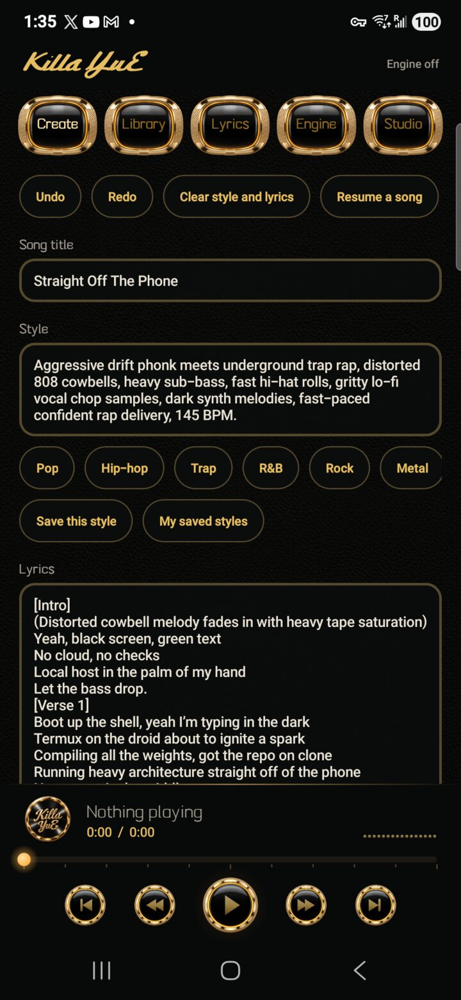</td><td>

### Create
Where a song starts. **Song title**, then **Style**: the genre, mood, instruments and voice in plain words; the chips (Pop, Hip-hop, Trap, R&B, Rock, Metal) add common styles, and **Save this style** keeps one to reuse. **Lyrics** are written in sections. **Undo** and **Redo** at the top cover every change on this screen, **Clear style and lyrics** starts over, and **Resume a song** finishes one that was interrupted.

</td></tr>
<tr><td>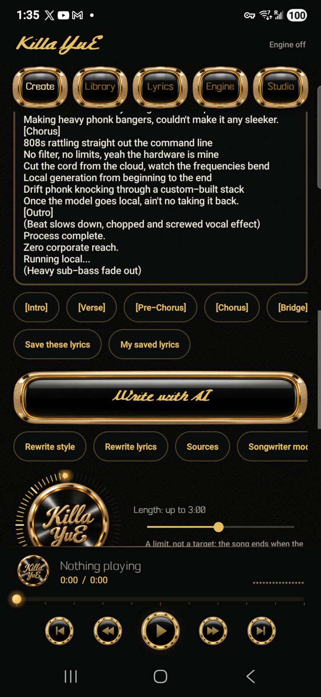</td><td>

### Lyrics and Write with AI
The section buttons add **[Intro] [Verse] [Pre-Chorus] [Chorus] [Bridge] [Outro]**. **Save these lyrics** keeps them under the song's title. The big **Write with AI** button runs a songwriter model on the phone: give it an idea and it writes the **title, style and lyrics** straight into the boxes (one Undo takes them back). **Rewrite style** and **Rewrite lyrics** redo one part, **Sources** shows what it looked up when it is allowed to search first, and **Songwriter model** picks or downloads its model.

</td></tr>
<tr><td>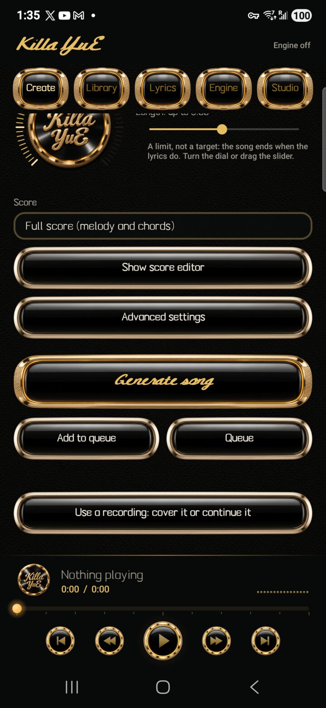</td><td>

### Length, score and generating
Turn the dial or drag the slider for the **length**: a limit, not a target, since the song ends when the lyrics do. **Score** sets how much the engine plans first: a full score with melody and chords, melody only, or none. **Show score editor** shows the written score (ABC notation) to read or change. **Advanced settings** holds render steps, variations, seeds, creativity, guidance, MP3 quality, file format and style adapters (LoRA). **Generate song** starts it now; **Add to queue** saves it for later and **Queue** shows what is waiting, so the phone can make songs overnight. **Use a recording** covers or continues a recording of yours.

</td></tr>
<tr><td>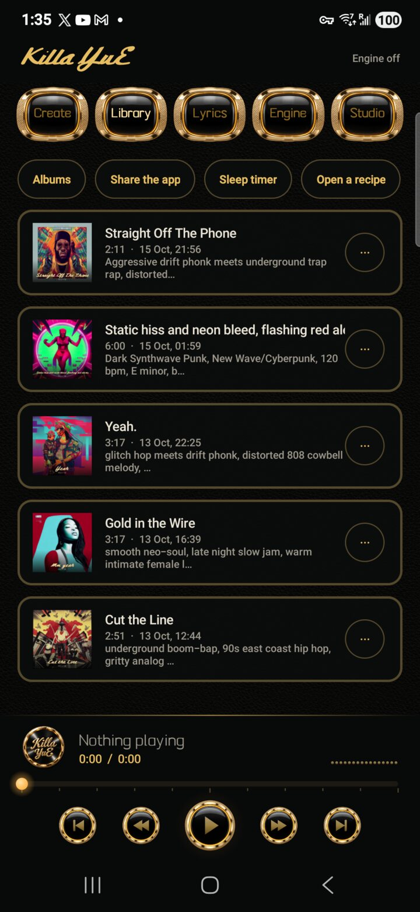</td><td>

### Library and the player
Every song you have made, with its cover, length, date and style. Tap one to play it in the gold player at the bottom (previous, rewind, play, fast forward, next, and a bar to drag through it). **Albums** groups songs, **Share the app** shows a QR code that installs Killa YuE on another phone, **Sleep timer** stops playback after a while, and **Open a recipe** loads a recipe (everything needed to make one exact song again, shared from another phone, without the audio).

</td></tr>
<tr><td>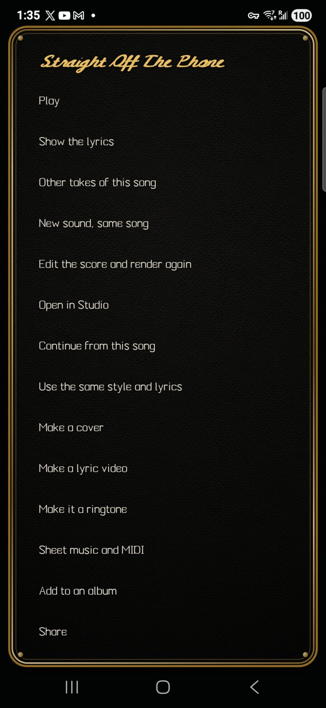</td><td>

### A song's options
The **⋯** beside a song: play it, show its lyrics in time, other takes, a **new sound with the same song**, edit the score and render it again, **Open in Studio**, continue it, reuse its style and lyrics, make an album cover, make a **lyric video**, set it as a **ringtone**, export **sheet music and MIDI**, add it to an album, and share it.

</td></tr>
<tr><td>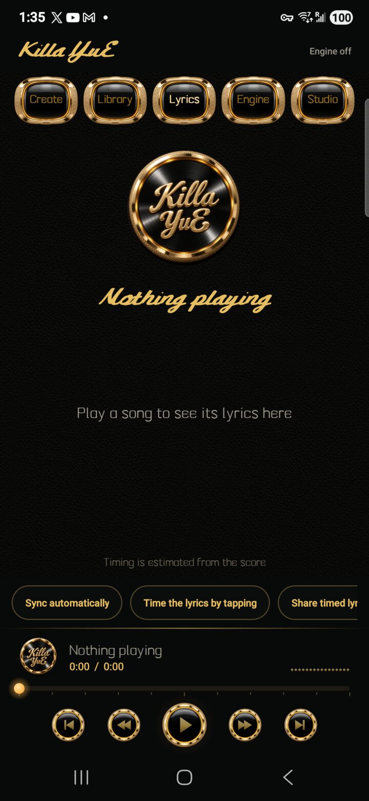</td><td>

### Lyrics, in time
The words of the playing song, lit line by line. **Sync automatically** listens to the song on the phone and times every line; **Time the lyrics by tapping** lets you tap along instead; **Share timed lyrics** sends the words with their timings.

</td></tr>
<tr><td>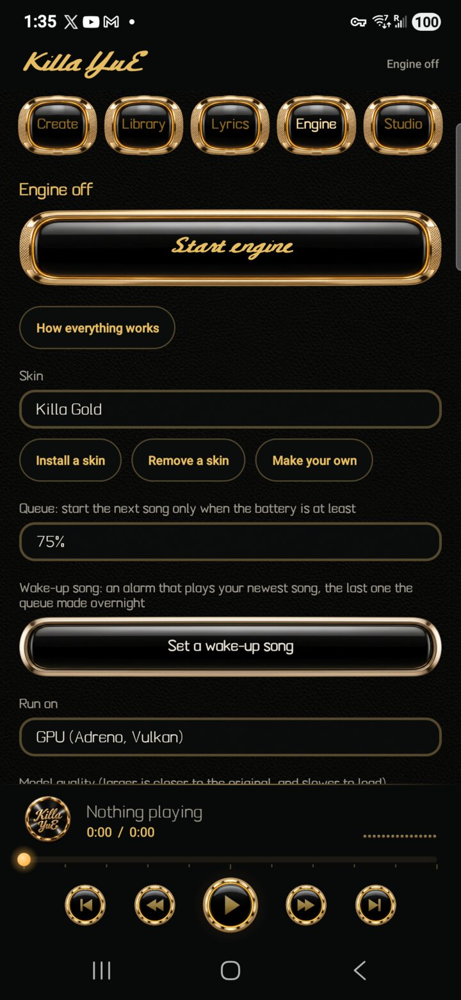</td><td>

### Engine
**Start engine** loads the song engine early to save a wait. **How everything works** opens the in-app guide. **Skin** changes the whole look; **Install a skin** adds a community skin from a file. Below: the queue's battery limit, a **wake-up song** alarm that plays the newest song from the overnight queue, **Run on** (GPU or CPU), **Model quality**, memory for song length, **Gentle mode**, **Studio jobs at full speed**, running the engine in its own process, the model downloads, and **Share the models by QR**.

</td></tr>
<tr><td>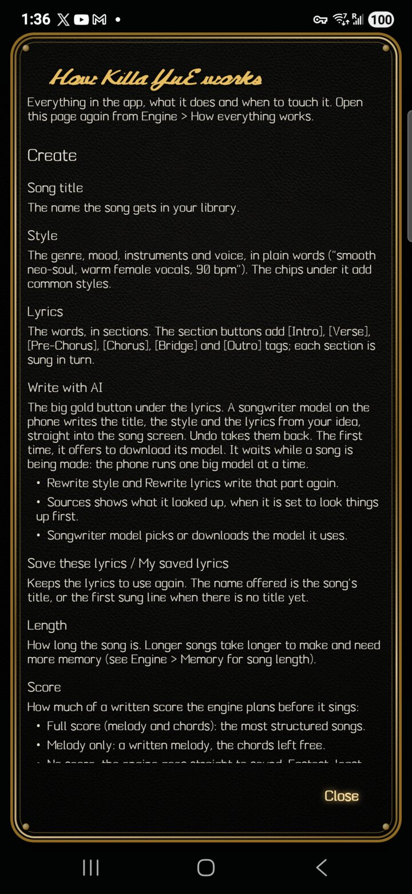</td><td>

### How everything works
The app's own manual, from **Engine**. It explains every setting and button on every screen, Studio included, in plain words with the defaults. It grows with every feature: see CONTRIBUTING.md.

</td></tr>
<tr><td>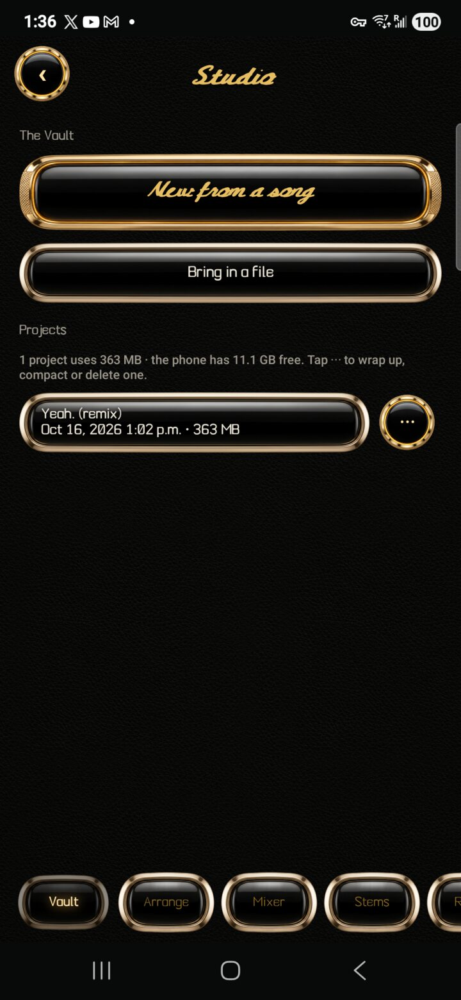</td><td>

### Studio: the Vault
A music studio inside the app. **New from a song** turns a song from your library into a project; **Bring in a file** starts one from any audio file. The line above the projects shows how much space they use and how much the phone has free. The **⋯** beside a project opens it, renames it, **wraps it up** (the mix goes into your library as a song, then you can delete the project to free its space), **compacts** it (removes audio nothing uses, keeping whatever Undo can bring back) or deletes it.

</td></tr>
<tr><td>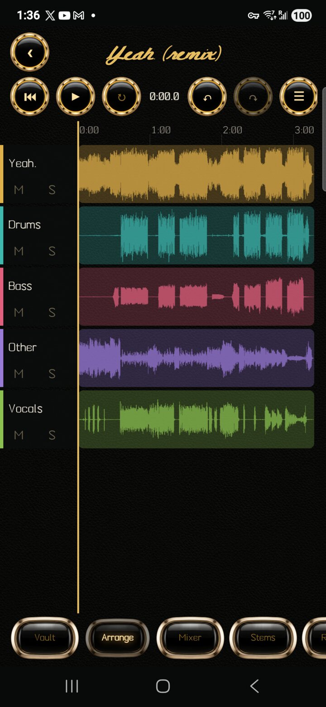</td><td>

### Arrange
The tracks laid out in time. The round buttons: back to the start, play and stop, loop (hold and drag the ruler to mark one), undo and redo (a whole drag is one step), the edit mode, and history. Tap the timeline to move the playhead and pinch to zoom; **M** mutes and **S** solos. The edit mode cycles **Navigate**, **Move clips** (snapped to the beat grid) and **Swipe comp** (build the best take from several). Hold a clip for its menu: move to the playhead, nudge, trim, **split**, duplicate, fades, **stretch and pitch** (25 to 400% of the length, −24 to +24 semitones) and remove.

</td></tr>
<tr><td>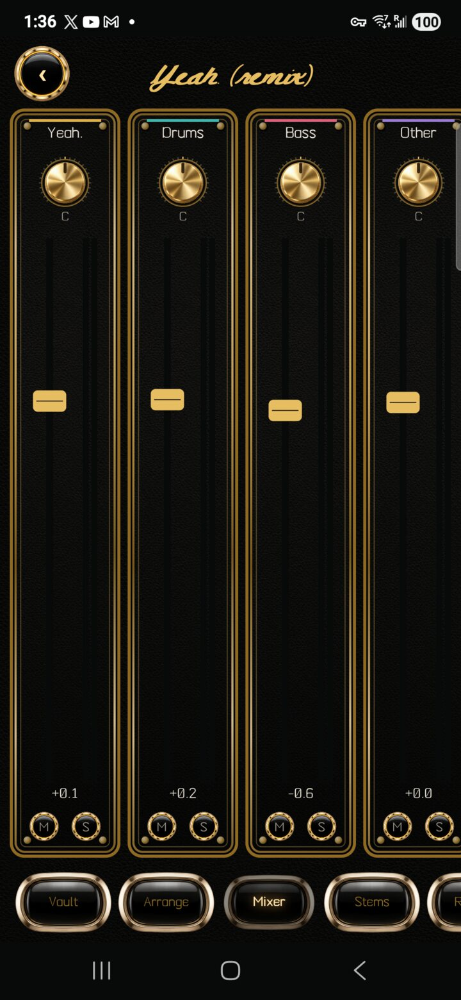</td><td>

### Mixer
A strip for every track and the master, each in a gold panel. Touch the **gold knob** and drag up or down to pan; touch the **fader's cap** and drag to set the volume; double-tap either to reset it. Anywhere else, swipe left and right along the strips. The meters show each track's level, and the small round **M** and **S** mute and solo.

</td></tr>
<tr><td>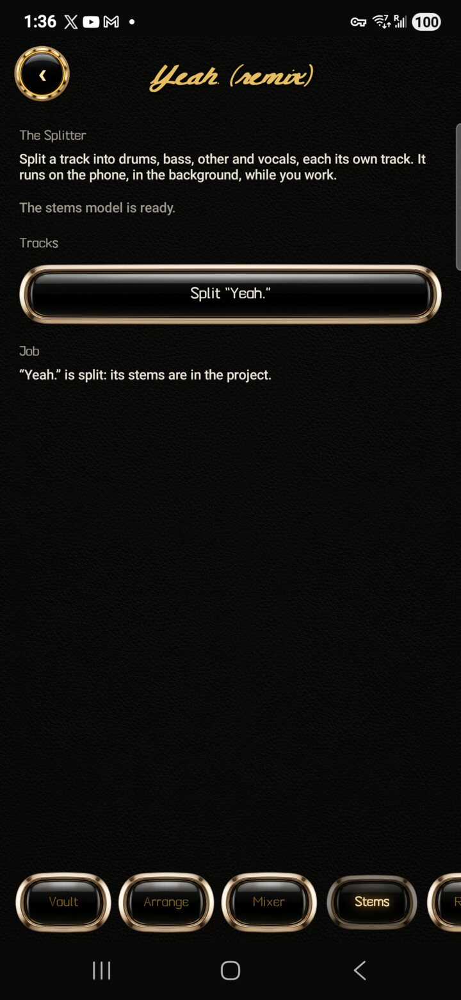</td><td>

### Stems
Splits a track into **drums, bass, other and vocals**, each its own track, on the phone with Meta's Demucs model (a 414 MB download, once). On the test phone a 3:17 song took about 23 minutes in the background (about 4× real time in a direct benchmark). Cancel stops it and Carry on resumes where it stopped. When it is done the four stems join the project in one step and the original is muted, so one Undo takes them away.

</td></tr>
<tr><td>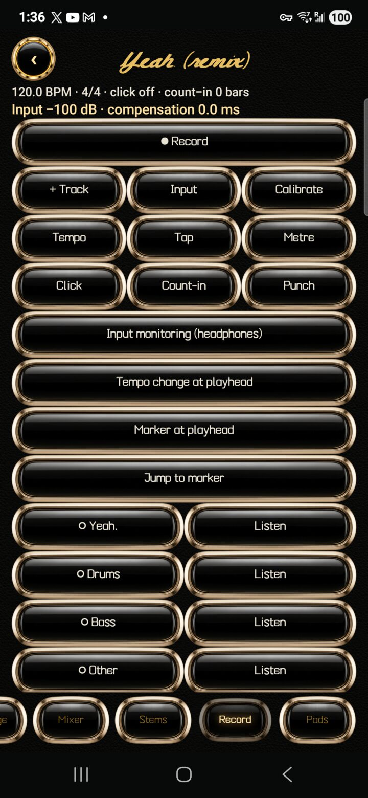</td><td>

### Record (Play Along)
Record over your song with the phone's microphone, a USB audio interface, or another app's sound. **+ Track** adds a track, the round arm button picks it, and **Record** plays the backing while it records; every take is kept. **Input**, **Input monitoring** (use headphones), **Calibrate** (measures and corrects the delay of your headphones or interface), **Tempo**, **Tap**, **Metre**, **Click**, **Count-in** and **Punch** (keep only the marked range) set up the take; loop recording keeps every pass as its own take. **Tempo change at playhead** and **markers** shape the song, and **Listen** mutes or unmutes each track. Interrupted takes are recovered when the project reopens.

</td></tr>
<tr><td>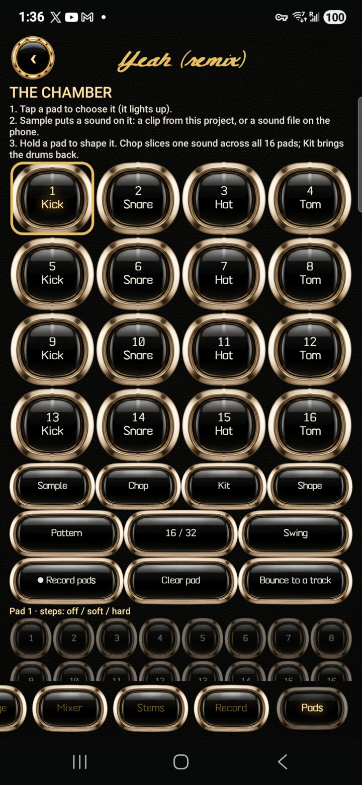</td><td>

### The Chamber: pads
Sixteen playable pads. Tap one to choose it (it lights up), then **Sample** puts a sound on it: a clip from the project or any sound file on the phone. **Chop** cuts one sound at its hits across all sixteen pads, **Kit** brings the built-in drums back, and holding a pad (**Shape**) sets one-shot, gate or loop, tune, envelope, low-pass, choke group, reverse, and **Start and Length** to play just part of a sound. **● Record pads** records your playing onto the step grid in time; **Clear pad** empties a pad; **Bounce to a track** turns the pattern into a **Pads** track you can mix, edit, move or delete like any stem. **Pattern**, **16 / 32** and **Swing** set the sequencer, and the numbered steps cycle off, soft and hard.

</td></tr>
</table>

## How fast is it

Measured on the test phone, Q6 model, GPU at full clock:

| | Time |
|---|---|
| Writing the score and melody | about 40 to 50 ms per token |
| 20-second song, 32 render steps | about 7 minutes |
| One render step of a 3-minute song | about 2 minutes |

A full-length song at the default 32 render steps takes around an hour. Eight steps is a reasonable first listen. Speed drops when the phone is hot, because Android slows the GPU; the app shows a line when that happens.

## How it works

- The engine is [yue2.cpp](https://github.com/ServeurpersoCom/yue2.cpp), a C++/GGML port of YuE2, built for Android and run as a child process of a foreground service. The app talks to it over `127.0.0.1`.
- The stock Qualcomm Vulkan driver crashed on the engine's first GPU computation on the test phone, so the APK carries its own driver: the Khronos Vulkan loader and Mesa's open-source **Turnip** driver, built for Android.
- Android's kernel kills GPU jobs that run for many seconds, which is exactly what rendering a long song is. A one-line patch to Turnip (in `engine/`) opts the engine out of that check.
- The user interface is plain Java with no Gradle and no support libraries, so the whole app can be built on a phone.

## Building

See [BUILDING.md](BUILDING.md).

## Licences

- App source: Apache License 2.0, see [LICENSE](LICENSE).
- Bundled third-party software: see [THIRD_PARTY_LICENSES.md](THIRD_PARTY_LICENSES.md).
- **YuE2 weights are not included and are not ours.** They are downloaded on request from Hugging Face and are licensed CC BY-NC 4.0 with the authors' creator permission. Individuals may use and monetise what they generate; companies need a licence from the authors for commercial use.
- The artwork in `art/` and `app/assets/materials/` was generated for this project with an image model and edited by hand.

Killa YuE is an independent project. It is not affiliated with or endorsed by M-A-P or the YuE2 authors.

## Contact

Bugs, device reports and ideas: please [open an issue](../../issues/new/choose).

For anything that should not be public, including security reports: **jackknifeai@proton.me**

## Who made this

Alexander, founder of JackKnife AI, and Claudia, his AI partner, who wrote the code. It went from an idea to a song in one day, on the phone it runs on.
