# Driver checks and volunteer retests for 1.6.2

Status: implementation for review. This does not release 1.6.2, certify a new GPU,
or enable unattended access to volunteer phones.

## What people get

The main app has **Settings → Compatibility checks**. Stop the song engine first.
The screen explains what runs, what is collected, how to stop, and how to report a problem.

1. **Check capabilities** queries the selected system Vulkan or bundled Turnip driver.
2. **Test calculations** runs F32, F16, Q5_K and Q6_K matrix multiplication with one and
   eight columns, using small nonconstant synthetic inputs and a CPU reference.
3. **Review and open GitHub** fills a dedicated Compatibility request issue. The person
   reviews and submits it in their browser. This is automatic form filling, not an
   authenticated background upload. Long reports fall back to copying the complete text.
4. **Save report as JSON** uses Android's document picker, without broad storage access.

No model download, song, microphone or screenshot is needed. A capability check is not
a numerical test; a numerical pass is not a complete music-generation or thermal test.
The app's current engine/driver preferences and working GPU defaults are unchanged.

The separate **Killa YuE Compatibility Lab** APK uses the same Java and native tests.
Its package is `ai.jackknife.killayue.compatlab`; it can coexist with the music app.
The first Lab APK targets ARM64 Android 9 or newer, matching the current native app payloads.
It declares **no Android permissions**, including no INTERNET permission, and shares
neither a UID nor storage with the music app. The external browser handles GitHub.
There is no ADB requirement, root, VPN, accessibility service, screen capture, remote
shell, boot service, automatic job polling or downloaded executable test code.

## What the calculation test actually establishes

The diagnostic executable links the candidate's **portable GGML** libraries and loads
the packaged CPU variants or Vulkan backend. It initializes the requested backend
directly; there is no scheduler that can silently move the test to CPU. It checks
buffer upload/readback and calculated results, including finite values.

Each matrix uses inner dimension 256, 16 rows, and 1 or 8 columns. Q5/Q6 reference
values are dequantized from the exact packed input. CPU activations are chosen to be
representable by its intermediate Q8 format. The reference uses double accumulation;
the numerical acceptance bound is `0.03 + 0.002 * abs(expected)`.

The test exits at the first unsupported operation or incorrect result. Eight distinct
successful cases and a successful process exit are required for `math_pass`.
Unsupported, unavailable, timeout, process death, cancellation and missing tests cannot
be treated as a pass. These small cases do not cover attention, KV-cache management,
large allocations, all tensor shapes, CPU ISA combinations, sustained heat or a song.

In particular, **portable GGML through Turnip is not the legacy static bundled song
engine**. Passing the diagnostic does not establish that the legacy engine's kernels
are correct. The report states its scope and hashes the diagnostic and backend binaries.
Do not advertise the phone as fully supported on this evidence alone.

The system GPU driver is provided by the phone vendor. We can test it and change our
backend/workarounds; this app cannot replace its kernel driver or manufacture missing
hardware features. Bundled Turnip changes apply only to supported Adreno/KGSL devices.

## Execution boundaries and limits

Tests execute as child processes, never in the UI process. The parent drains stdout
and stderr independently, bounds retained output at 64 KiB per stream, and discards raw
stderr after extracting a fixed allowlist of Vulkan error codes. The last started test
is retained to identify where a native crash or timeout happened.
Capability discovery has a 20-second deadline and the math suite a 90-second deadline.
Stop, Back, or leaving the screen cancels the running test. Native child processes have
the enclosing app's UID; process separation is crash containment, not an extra Android UID.
The separate beta APK provides the stronger separation from the music app's data.

Before math and once per second during it, the runner checks battery and memory:
below 20% battery, at least 40°C reported battery temperature, Android thermal status
SEVERE or above, low-memory status, or less than 512 MiB available memory stops/defer tests.
These are conservative project limits, not manufacturer temperature specifications.
A driver/kernel hang can outlive a process timeout or reset the device; no app sandbox
can guarantee containment of a defective kernel GPU driver. Instructions say this clearly.

Reports contain model/manufacturer, Android API and firmware build/incremental/security-patch revision, CPU/GPU capabilities,
APK/native binary hashes and synthetic test outcomes. The device configuration digest groups
the same model/firmware/GPU/selected backend; it is not a unique phone ID. Stock-driver versions
also participate in the match, so an OTA/driver update cannot silently count as an app fix.
Bundled-driver versions are recorded separately so a new Turnip candidate can be retested on the same hardware cohort.
No serial, Android ID, account, installed-app inventory, IP address, song, lyric, screenshot
or general engine log is collected by the diagnostic code. Reports stay in private app
storage unless the person explicitly exports them. Public GitHub reports are tied to the
person's GitHub identity and may reveal an uncommon device configuration; they are not anonymous.

## The fix and retest loop

```mermaid
flowchart LR
    A[Tester reviews and submits report] --> B[Validate report and label compatibility issue]
    B --> C[Maintainer starts AI proposal]
    C --> D[Draft PR and CI]
    D --> E[Review and build signed beta APK]
    E --> F[Create targeted retest request]
    F --> G[Volunteer imports request and runs test]
    G --> H[Validate returned report against request]
    H -->|failure or incomplete| B
    H -->|targeted pass| I[Review evidence and full-generation tests]
    I --> J[Maintainer decides merge and release]
```



**Report handling is automatic.** `.github/workflows/compatibility-reports.yml` handles
issues whose title starts with `[Compatibility]`. It validates one bounded JSON block,
rejects unexpected fields and malformed numerical results, and labels the issue.
It never executes instructions from issue text. It uses hosted runners, not ops or a phone.

**AI proposals require a maintainer dispatch.** In Actions, run **Compatibility AI fix
and retest**, choose `propose-fix`, and supply the report issue number. The workflow
validates the report, runs Codex in a restricted proposal job, then passes a text patch
to a fresh publishing job. That job permits only defined Java/C++/patch/doc paths and
rejects binary files and symlink patches. It creates a **draft** PR and explicitly starts
Check CI, because a bot-created PR does not normally trigger another workflow.

Codex has no phone access or release-signing credentials. The proposal job's GitHub token
has read permissions. The separate publishing job has the rights needed to open the PR
and trigger CI but does not execute proposed source code. Human review must check that
the change fixes the failure rather than weakening tests or broadening a device whitelist.
An insufficient-evidence response may produce no patch and no PR; inspect its saved output.

**Candidate build/signing is a reviewed step.** Build a beta APK from the exact candidate
commit with the same portable libraries and intended driver. Sign it with the maintained
Compatibility Lab signing identity, publish it as a prerelease asset in this repository,
and retain its SHA-256 and build provenance. A signed asset's hash does not itself prove
which source commit produced it; the maintainer must verify that provenance. This first
iteration does not give AI jobs a signing key or publish arbitrary generated APKs.

Then dispatch the same workflow with `request-retest`, source issue, candidate PR number,
APK SHA-256 and APK asset URL. The workflow requires completed successful CI check runs,
downloads the repository-owned APK URL and checks its digest. It creates:

- a downloadable `retest-request.json` artifact and instructions on the original issue;
- a record binding request ID, issue, candidate APK, PR commit, driver, suite and hardware cohort;
- a pending `compatibility/<request-id>` status on the candidate commit.

The volunteer installs the candidate, opens **Open a retest request** in Compatibility Lab,
selects the JSON file, reviews the request and runs it. Only predefined suites/drivers
are accepted. It cannot name an executable, supply a URL, load a shader, set environment
variables, or choose arbitrary dimensions. New test code arrives in signed APK updates.

The app refuses a request for a different APK hash or hardware cohort. A submitted retest
must also match the maintainer-generated request stored by the repository's workflow bot.
If the PR changed in the meantime, a new request is required. A complete math pass records
`targeted_pass`; failures and incomplete runs record `needs_followup`. Neither closes the
source issue, merges a PR, publishes a release, nor certifies full music generation.
Hardware reports are volunteer-supplied evidence, not cryptographic hardware attestation.
Keep a separate status for each requested device; one passing phone must not clear another.

On a failed retest, the follow-up label and linked result return to the same issue queue.
A maintainer can start another AI proposal using the new report issue. A fresh build and
request are needed for the next iteration. Automatic paid AI retries are intentionally
not enabled by a public issue submission.

## Configuration and cost

Local checks, report export and retest matching do not call an AI API and require no reporting
server. Standard GitHub Actions usage remains subject to the repository/account's quotas.
AI proposals require an `OPENAI_API_KEY` repository secret and the repository variable
`COMPATIBILITY_AI_ENABLED=true`. Leave the variable unset for a functioning non-AI workflow.
The Codex Action is a separate automated run, not a continuation of a maintainer's chat.
API usage needs its own budget; a workflow timeout is not a hard dollar-spend cap.
Use project billing controls and trusted dispatchers before enabling it. No credentials
belong in either APK. Repository Actions must be allowed to create pull requests.

The workflows become available after they are merged into the default branch. No live
volunteer session or AI API run is claimed by merely adding these files.

## Build and verification

Build the diagnostic executables against the exact candidate portable GGML source and binaries:

```sh
bash engine/build-compatibility.sh YUE_SOURCE PORTABLE_LIB_DIR ANDROID_NDK VULKAN_HEADERS OUTPUT
```

Set `COMPATIBILITY_DIR=OUTPUT` for both `app/build.sh` and `compatlab/build.sh`.
The Lab build also needs `ANDROID_JAR`, `BUILD_TOOLS`, `PORTABLE_ENGINE_DIR`, `DRIVER_DIR`
and `LIBCXX`. It outputs an unsigned APK, or a signed APK when `KEYSTORE`, `KS_ALIAS` and
`KS_PASS` are provided. The normal app signing configuration can be used, but a dedicated
maintained Lab signing key reduces exposure. Never commit keys or native binaries.

```sh
bash compatlab/test/run.sh
ANDROID_JAR=/path/android.jar BUILD_TOOLS=/path/build-tools bash app/check.sh
bash compatlab/build.sh /path/to/output
```

Before shipping: verify APK signatures, package separation, absence of Lab permissions,
native alignment/dependencies, and the included binary hashes. Exercise capability and
math checks, cancellation, background cancellation, missing Vulkan, a known failing GPU,
report preview/export, request import, wrong-build rejection, and the complete issue →
request → returned-result workflow. Confirm music generation and existing GPU selection
have not regressed on currently supported physical devices. Retest thermal behavior and
full generation separately. Desktop tests and a successful build do not satisfy these gates.

References: [Android application sandbox](https://source.android.com/docs/security/app-sandbox),
[dynamic code loading](https://developer.android.com/privacy-and-security/risks/dynamic-code-loading),
[GitHub issue URL parameters](https://docs.github.com/en/issues/tracking-your-work-with-issues/using-issues/creating-an-issue),
[GitHub script injection guidance](https://docs.github.com/en/actions/concepts/security/script-injections),
[Codex GitHub Action](https://learn.chatgpt.com/docs/github-action).
